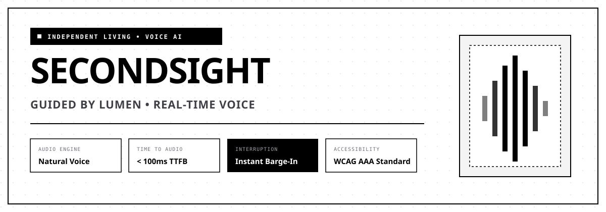
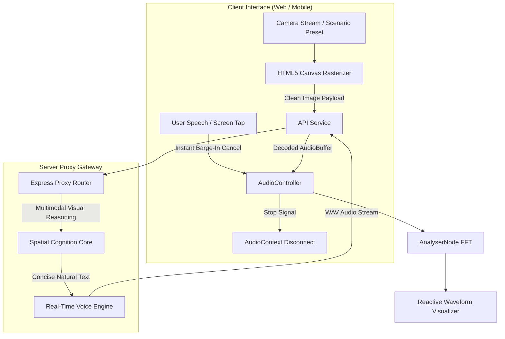

<div align="center">



# SECONDSIGHT
### Intelligent Visual Companion • Guided by Lumen

[](#-real-time-voice-architecture)
[](#-core-capabilities)
[](#-real-time-voice-architecture)
[](#-real-time-voice-architecture)
[](#-accessibility-matrix)
[](#license)

<p align="center">
  <strong>SecondSight</strong> transforms any smartphone camera or desktop webcam into an empathetic, ultra-low latency voice guide named <strong>Lumen</strong>. Engineered for blind and low-vision individuals, SecondSight translates spatial geometries, hazards, prescription labels, and personal belongings into clear, comforting natural speech.
</p>

[Key Features](#-executive-overview) • [Assistive Capabilities](#-core-capabilities) • [Voice Pipeline](#-real-time-voice-architecture) • [API Reference](#-api-specification) • [Getting Started](#-getting-started) • [Accessibility](#-accessibility-matrix)

---

</div>

## 🌟 Executive Overview

Everyday environments are filled with dynamic obstacles, fine-print medication instructions, and misplaced items. Traditional screen readers often produce robotic, monotonic speech, suffer from multi-second latency, and cannot be interrupted cleanly.

**SecondSight** solves this with a purpose-built acoustic and visual architecture:

* **Intelligent Scene Perception**: Real-time scene interpretation formatting physical space into intuitive clock-direction bearings (*"Doorway at 12 o'clock, 3 paces away; step down at 11 o'clock"*).
* **Next-Generation Speech Engine**: Expressive, reassuring spoken cadence with **sub-100ms time-to-first-byte (TTFB)** audio playback.
* **Conversational Barge-In**: Instant audio interruption whenever the user speaks or taps the screen—creating a natural, respectful dialogue rather than a forced monologue.
* **Resilient Dual-Engine Audio**: Primary high-fidelity voice synthesis backed by automated on-device browser speech synthesis for uninterrupted guidance even during cellular drops.
* **High-Contrast Brutalist Aesthetic**: A pure white editorial design system with sharp 90-degree rectangular boundaries (zero border-radius) optimized for maximum visibility and contrast.

---

## 🎯 Core Capabilities

| Mode | Target Use Case | Spoken Output Example |
| :--- | :--- | :--- |
| **01. Spatial Navigator** | Steps, curbs, doorways, overhangs, and walking clearances. | *"Doorway at 12 o'clock, three paces ahead. Minor step down at 11 o'clock. Reach out for the handrail on your left."* |
| **02. Instant OCR Reader** | Prescription labels, street signs, restaurant menus, mail. | *"Prescription for Amoxicillin 500mg. Take one capsule every 8 hours with meals. Finish all medication."* |
| **03. Object & Item Locator** | Keys, medication vials, glasses, wallet, mugs. | *"Found your keys on the desk at 10 o'clock, approximately arm's length away, beside a dark notebook."* |
| **04. Color & Wardrobe Stylist** | Garment coordination, shades, textures, lighting ambiance. | *"A deep navy blue knit sweater paired with charcoal trousers. The contrast is sharp and complementary."* |
| **05. Conversational Co-Pilot** | Freeform dialogue, questions about scene atmosphere. | *"The room is brightly lit with ambient morning sunlight. Two people are sitting by the window enjoying coffee."* |

---

## 🎙️ Real-Time Voice Architecture

SecondSight is built around an ultra-low latency, bidirectional speech and vision loop:



### Acoustic Engineering Highlights
1. **Expressive Natural Voice**: High-clarity spoken audio with human-like cadence, inflection, and accurate enunciation of complex medical and technical terms.
2. **Instant Barge-In**: The client communicates cancellation instantly via the audio controller, cutting audio playback in milliseconds without breaking session state.
3. **Reactive Waveform Analysis**: The frontend analyzes frequency bins via the Web Audio API `AnalyserNode`, animating a responsive tactile soundwave visualizer.
4. **Guaranteed Reliability**: Seamless automated fallback to browser-native speech synthesis if network connectivity becomes unavailable.

---

## 🔒 Security & Privacy by Design

Assistive technology handles intimate views of a user's home, documents, and medical items. SecondSight is built on strict zero-trust privacy:

* **Zero Frontend Exposure**: No API credentials, access tokens, or secrets are ever bundled, transmitted to, or stored in client-side code.
* **Server-Mediated Proxy**: All requests are authenticated, rate-limited, and verified server-side.
* **Ephemeral Memory Processing**: Camera frames and snapshots are evaluated exclusively in volatile RAM and immediately discarded. No video streams, photos, or voice audio are permanently logged or stored on disk.
* **Opt-Out of Data Training**: External inferences are routed with strict privacy flags to prevent data retention.

---

## 🧪 Interactive Demo Testbench

SecondSight includes a built-in **Scenario Gallery** featuring 5 pre-rendered living environments for instant desktop evaluation:

| Scenario | Mode | Evaluation Target |
| :--- | :--- | :--- |
| **Staircase & Drop-off** | `navigate` | Detects descending steps, handrail orientation, and floor transition hazards. |
| **Prescription Bottle** | `read` | Extracts medication name, dosage frequency, and safety warning labels. |
| **Lost Keys on Desk** | `find` | Locates small metallic items relative to user position using clock-face bearings. |
| **Wardrobe Coordination** | `color` | Differentiates subtle fabric tones (navy vs. olive) and evaluates outfit harmony. |
| **Pedestrian Crosswalk** | `navigate` | Identifies tactile paving warning blisters, street zebra stripes, and walk signals. |

---

## 📡 API Specification

The backend server exposes clean, vendor-agnostic REST endpoints:

### `GET /api/config`
Retrieves system health and feature readiness:
```json
{
  "status": "ok",
  "appName": "SecondSight",
  "companionName": "Lumen",
  "voiceReady": true,
  "visionReady": true
}
```

### `POST /api/analyze`
Analyzes an image frame and returns concise, friendly spoken guidance.
* **Payload**:
  ```json
  {
    "image": "data:image/jpeg;base64,...",
    "mode": "navigate",
    "query": "What obstacles are ahead?"
  }
  ```
* **Response**:
  ```json
  {
    "text": "The path ahead is clear for three paces. Doorway at 12 o'clock.",
    "mode": "navigate",
    "source": "verified",
    "timestamp": 1731000000000
  }
  ```

### `POST /api/tts`
Synthesizes text into high-fidelity conversational audio.
* **Payload**: `{ "text": "Path is clear. Proceed with care." }`
* **Response**: Binary `audio/wav` stream (`Content-Type: audio/wav`).

### `POST /api/chat`
Conversational follow-up dialogue with Lumen.
* **Payload**: `{ "messages": [{ "role": "user", "content": "Is the floor wet?" }], "mode": "general" }`
* **Response**: `{ "text": "The surface appears dry with a matte wooden finish." }`

---

## ⚡ Getting Started

### Prerequisites
* **Node.js**: v18.0.0 or higher (v20+ recommended)
* **npm**: v9.0.0 or higher
* Valid voice and vision provider API keys

### 1. Clone & Install
```bash
git clone https://github.com/0xanjalii/secondsight.git
cd secondsight
npm install
```

### 2. Configure Environment Variables
Create your local environment file:
```bash
cp .env.example .env
```

Populate `.env` with your API credentials:
```env
# Voice Services
ASSEMBLYAI_API_KEY=your_voice_api_key_here
ASSEMBLYAI_VOICE_ID=49c443a4-8a1d-5f7e-b70b-98bdbd9823c3

# Spatial Perception Core
OPENROUTER_API_KEY=your_vision_api_key_here
OPENROUTER_MODEL=openai/gpt-4o-mini
OPENROUTER_MAX_TOKENS=250

# Web Server Configuration
PORT=3000
```

### 3. Run Application

#### Development Mode (Vite HMR + Server)
```bash
npm run dev
```
* **Frontend UI (Hot Reload)**: [http://localhost:5174](http://localhost:5174)
* **Backend API Gateway**: [http://localhost:3000](http://localhost:3000)

#### Production Mode
```bash
npm run build
npm start
```
The optimized bundle is served directly at [http://localhost:3000](http://localhost:3000).

---

## ♿ Accessibility Matrix

SecondSight is built to satisfy **WCAG 2.2 Level AAA** criteria:

| Accessibility Feature | Implementation Standard | Benefit |
| :--- | :--- | :--- |
| **Contrast Ratio** | $\ge$ 7:1 across all text, borders, and buttons | Optimal legibility for individuals with low vision or cataracts. |
| **Geometry** | Zero border-radius (sharp 90° rectangular boundaries) | Crisp, unmistakable element delineation without visual distortion. |
| **Live Announce** | `aria-live="polite"` regions on transcripts | Screen readers narrate responses naturally without interrupting speech. |
| **Touch Targets** | Minimum 48×48px interactive boundaries | Easy targeting for users with motor tremors or tactile navigation. |
| **Haptic Feedback** | `navigator.vibrate(30)` on speech initiation | Non-visual tactile confirmation that Lumen has begun speaking. |
| **Keyboard Controls** | <kbd>Space</kbd> to scan, <kbd>Esc</kbd> for instant barge-in | Total hands-free and keyboard-only operation. |

---

## 📁 Repository Structure

```
secondsight/
├── assets/
│   └── banner.svg               # Vector brand banner for documentation
├── public/
│   └── favicon.svg              # High-contrast geometric square vector favicon
├── src/
│   ├── components/
│   │   ├── Navbar.tsx           # Accessible header with audio & contrast toggles
│   │   ├── HeroSection.tsx      # Editorial headline, metrics, and call-to-actions
│   │   ├── LiveViewfinder.tsx   # Video feed, radar HUD, scenario bench, and voice loop
│   │   ├── ModesGrid.tsx        # 4 assistive living modules grid
│   │   ├── ThreeSteps.tsx       # System operating sequence
│   │   ├── SpeechPillars.tsx    # Real-time voice architecture & latency breakdown
│   │   ├── FaqAccordion.tsx     # Frequently asked questions accordion
│   │   └── Footer.tsx           # Editorial footer with status monitors
│   ├── data/
│   │   └── presets.ts           # 5 interactive scenario presets
│   ├── services/
│   │   └── api.ts               # Secure frontend API client
│   ├── utils/
│   │   └── audioPlayer.ts       # AudioContext, AnalyserNode, and Web Speech controller
│   ├── App.tsx                  # Main application container
│   ├── index.css                # Custom brutalist borders, radar sweep, and scrollbar
│   └── main.tsx                 # React DOM bootstrapping
├── .env.example                 # Configuration template
├── index.html                   # HTML entrypoint with typography & Tailwind config
├── package.json                 # Project dependencies & scripts
├── server.js                    # Express proxy server for voice & vision endpoints
└── vite.config.ts               # Vite bundler configuration
```

---

## 📄 License

This project is licensed under the [MIT License](LICENSE).

<div align="center">
  <p><strong>Designed with respect, empathy, and technical rigor for independent living.</strong></p>
  <p>© SecondSight. Guided by Lumen.</p>
</div>
